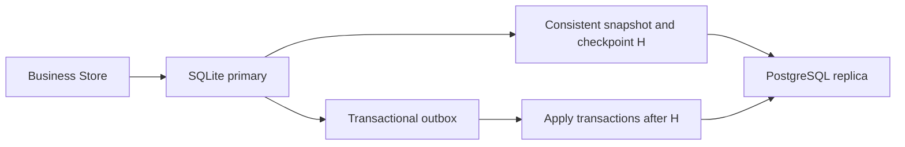

# Online SQLite to PostgreSQL Migration Plan

[中文](zh/sqlite-postgres-online-migration.md)

Status: implementation and local acceptance delivered; production rehearsal remains open.
Branch: `feat/sqlite-postgres-online-migration`. Tracking: [qbox/sandbox#535](https://github.com/qbox/sandbox/issues/535).
This branch includes explicitly enabled migration commands, disabled by default. See section 11 for operations.

## 1. Goal and boundaries

Move current runnerd business data to PostgreSQL while SQLite continues serving traffic.
Do not wait for running Runners/Deployments, recreate Sandboxes, or require users to sign in again.
Final cutover keeps the same runnerd process, scheduler, callbacks, SSE connections and PTYs.
Database operations may queue within a measured budget; zero latency is not promised.

- Business writes and migration changes commit atomically; interruptions, duplicate delivery and process exits must not create replication gaps.
- Exactly one business primary exists. Multi-instance execution, automatic failover and distributed transactions are outside scope.
- Reverse replication supports a controlled rollback after catching up, not an immediate lossless return to a stale SQLite file.
- Do not clean historical payloads, tables or logs, or change lifecycle, authorization, capacity or audit semantics.
- Migration is disabled by default. This plan does not authorize commits, pushes, production deployment or production data operations.

Installing the preparation release still upgrades the existing process. Current startup recovery returns 503 for most routes,
and PTY state lives in memory. That upgrade needs separate connection-draining, ingress and recovery acceptance;
successful database migration does not establish seamless process upgrades or multi-instance safety.

## 2. Pre-migration baseline and implementation evidence

- `internal/state/db.go`: existing SQLite/PostgreSQL/MySQL drivers, SQLite WAL and one business connection; no replication or hot switching.
- `internal/state/store.go`: the composed Store interface serves HTTP handlers, Runner callbacks and the Deploy worker.
- `internal/state/identity_audit.go`: mutations and audit events must commit or roll back together.
- `internal/state/deployments.go`: event eviction, append and budget updates share a transaction; revisions and attempts must survive.
- `internal/state/runner_requests.go`: optimistic version checks and direct event writes. Source log-write failures are currently warnings and must remain distinguishable from replication failures.
- `cmd/runnerd/main.go` and `internal/server/server_terminal.go`: startup gates and process-owned sessions preclude simply rolling between two full instances with separate databases.
- `.github/workflows/check.yaml`: existing real-dialect schema/audit/deployment gates are extended with migration and server continuity checks on this branch.

## 3. Data inventory and protocol

Maintain an explicit versioned inventory derived from current GORM models, including columns, primary keys and types.
Never migrate arbitrary discovered tables automatically. The 18 current tables are:

| Domain | Tables |
| --- | --- |
| Runner | `runner_requests`, `runner_events`, `runner_profiles`, `scoped_runner_profiles` |
| Deploy | `deployments`, `deployment_revisions`, `deployment_events` |
| Identity/access | `accounts`, `oauth_identities`, `github_installations`, `github_installation_owners` |
| Configuration | `account_preferences`, `account_secrets`, `sandbox_service_defaults`, `sandbox_service_default_audiences` |
| Sponsorship/audit | `fork_sponsorship_policies`, `fork_sponsorship_approvals`, `audit_events` |

Preflight rejects missing columns, unrepresentable values, key conflicts and uncovered active writers.
Report counts of extra columns/retired tables and retain the original database/backup. Custom source indexes remain in that file;
operators must inventory them and review target query plans rather than automatically copying dialect-specific indexes. Do not restore retired features.
Inert compatibility fields such as `runner_profiles.default_available` must remain inert.

Separate migration control/outbox tables from the business inventory. A migration has a unique ID, protocol version,
schema fingerprint, source/target instance identities, direction, epoch, phase, checkpoints and baseline progress.
Instance identities must not contain plaintext DSNs. Resume requires the same migration/target/protocol;
unknown phases and incompatible schema/protocol versions fail closed.

## 4. Transactional change capture

Use an outbox in the primary transaction, storing final row images and deleted keys rather than replaying business methods or external actions.
Calling two Stores sequentially or relying only on GORM save callbacks is insufficient.

1. Inventory every mutation, raw SQL statement, `UpdateColumns`, bulk deletion, callback and startup backfill.
2. Establish one state write-transaction boundary, binding nested Stores to the transaction and migration epoch.
3. Record ordered transaction groups and row changes, preserving keys, NULLs, booleans, UTC times, versions and ciphertext.
4. Roll back both business and outbox changes on either failure. An in-memory queue after business commit is insufficient.
5. SQLite triggers may complete row coverage, but must integrate with transaction grouping and cover raw SQL, deletes and batches.
6. PostgreSQL reverse capture must follow committed transaction order. An auto-increment outbox ID is not commit order.
   During observation, serialize write transactions with an explicit transaction lock or provide an equivalent committed-transaction protocol.

Apply complete source transactions and target checkpoints atomically. Replaying after a crash is idempotent.
Only replication may write the designated replica; suppress capture of replication writes to avoid loops.
Source rollbacks expose no changes. Never decrypt credentials or log row payloads, SQL parameters or provider details.

Mixed protocol/old writers and manual business writes that bypass capture are unsupported during migration.
Coordinate schema upgrades explicitly. Reclaim changes only after baseline, both consumers and recovery no longer need them.
Bound retention/backlog and monitor disk headroom. Target failure pauses replication and blocks cutover;
indefinitely exhausted source storage cannot preserve availability and requires early alerts and an agreed response.

The preparation release uses these explicit structures, created only when migration is enabled:

- `runnerd_migration_control`: migration ID, protocol/schema fingerprint, database role, epoch and active write group.
- `runnerd_migration_transactions`: ordered positions for source write groups;
  `runnerd_migration_changes`: table, key, operation and final row images for each group.
- `runnerd_migration_checkpoints`: replica progress committed atomically with applied business rows.
- Intercept GORM `ConnPool.BeginTx` to group explicit and automatic write transactions without changing existing business atomicity.
  SQLite row triggers capture actual changes. Keep GORM default write transactions enabled;
  raw mutation SQL must run inside a managed transaction, and bypasses fail closed.
  Nested audit transactions and savepoints share the group; rolling back a savepoint removes its captured changes too.
- Before any PostgreSQL business SQL during observation, lock the control row and then allocate the group position.
  This explicitly serializes write transactions so a lower position cannot commit late and be skipped.
- Replica application establishes a restricted replication context within the target transaction, suppressing recapture
  while ordinary replica business writes remain forbidden. Startup backfills are managed writes too;
  an active migration rejects a changed schema fingerprint rather than silently executing incompatible DDL.

Each transaction header records its committed predecessor. `runnerd_migration_frontiers` stores the epoch's
committed tail in the same business/outbox transaction. Replay validates both the chain and frontier;
normal rollback allocation gaps are accepted, but removed intermediate/tail groups reject advancement.

## 5. Online baseline and incremental copy



Enable capture before taking a consistent SQLite snapshot containing checkpoint H.
Use an independent connection rather than occupying the single business connection, with bounded batches,
bandwidth, lock waits, snapshot lifetime and WAL growth. Separate read views must not masquerade as one snapshot.
For online backup, read H from the backup itself; copying a live `.db` alone is not a consistent WAL backup.

The implementation uses SQLite `VACUUM INTO` to create a resumable read-only baseline, not an in-place source `VACUUM`.
An independent connection reads a consistent WAL-mode view. Sync the output file and parent directory, then validate
permissions, instance/epoch, integrity and the artifact's own checkpoint. Import uses immutable/read-only access to
the completed file rather than holding an online read transaction. Creation requires a caller deadline;
cancellation removes only this call's newly-created artifact.

The artifact SHA-256 binds resumable progress. `runnerd_migration_baseline` stores source identity/epoch,
schema fingerprint, H, table index, last composite key and copied row count. A page contains at most 1,000 rows;
rows and progress commit together. Reject another artifact, a nonempty target, replay before a completed baseline,
identity drift and a rewound source. Incremental reads also use an independent SQLite pool and a deadline-bound
read transaction. Stream up to 256 changes per page, committing the complete source group and target checkpoint
once rather than splitting a source transaction at page boundaries.

Normalize times to UTC and truncate to PostgreSQL microseconds without rewriting original SQLite timestamps.
Both comparison sides use that normalization; nanosecond tails are not preserved. Real PostgreSQL tests verify
existing `updated_at = ?` parameter binding agrees with this precision. Parse integers without float conversion,
retaining IDs above 2^53, NULLs, false, zero values and ciphertext. Reject out-of-range numbers, invalid UTF-8 and
NUL text that PostgreSQL cannot represent. Target driver errors can contain entire rows, so expose only server-owned
error categories, never underlying driver details or parameters.

Create the explicit target schema, import the baseline, then replay after H to prevent stale baseline overwrites.
Import bypasses lifecycle methods, policy backfills, automatic timestamps and business audit hooks.
Persist progress and cancellation/resume semantics. Failure never changes primary identity.
Reject a nonempty target unless its migration identity and resume progress match.

## 6. Verification and cutover gates

Verify in inventory/key order. Canonical row encoding includes column types, NULLs and values so time precision,
boolean representations, NULL versus empty strings and encrypted fields are checked correctly.
Never expose plaintext secrets or ciphertext payloads in reports.

- Complete chunked row-count/digest checks at matching replication checkpoints.
- Track dirty chunks and verify them and the final delta before cutover; do not scan the full database behind the operation barrier.
- Check versions, Sandbox/PID, attempts, revisions, leases, event budgets, authorization links and audit completeness.
- Preserve all IDs and event cursor ordering. Sequence correction must include historical allocation high watermarks, not only current `MAX(id)`.
- Preserve `auth.session_secret`, `auth.encryption_key` and ciphertext, and verify existing cookies and credentials.
- Require complete capture, healthy/caught-up replication, verified data, prepared reverse capture and sufficient capacity.

## 7. Cutover in the existing process

Keep a stable Store facade and swap its underlying Store without replacing Server, workers, Terminal Hub or Sandboxes.
Pin every operation and complete transaction to one Store/epoch. Raw GORM handles must not escape the operation lifetime.

1. Queue new database operations behind a bounded, timed barrier and drain existing operations.
2. Include APIs, schedulers, sweepers, logs, exit callbacks and Deploy; never hold the barrier while waiting on provider/GitHub calls.
3. Freeze final committed checkpoint F, finish replication/delta verification and correct target sequences.
4. Commit durable primary authority/epoch through the control protocol and switch the facade.
5. Release queued work, preserve existing tasks/SSE/PTYs and replicate PostgreSQL changes back to SQLite.

Budget or validation failure cancels cutover and releases operations to SQLite.
The generated complete Store facade pins whole methods and audit callbacks; regenerate it with
`go generate ./internal/state`. New interface methods fail compilation until forwarded. Void log calls queue too.
Crossing the queue budget cancels preparation; all calls wait for safe role restoration. This is an abort threshold,
not a hard queue cap implemented by rejecting overflow calls. After authority commit, recover the new primary instead
of cancelling to the old one.
Do not stop HTTP or reject normal requests and label that seamless migration; measure request and lease budgets.
Latency thresholds depend on ingress and rehearsal, not an unverified fixed millisecond promise.

The authority protocol must define an explicit durable commit point. Source, target and a local manifest cannot commit atomically.
Specify crash recovery after every prepare/commit step, use confirmed durable authority, and reject business writes when authority is ambiguous.
After commitment, stale DSN configuration or temporary PostgreSQL unavailability must never trigger automatic fallback to SQLite.

Use a local durable authority manifest as the sole cutover commit point, matching the single-process deployment boundary.
The restricted migration directory contains instance identities, epoch, positions and phase, never DSNs or keys.
Commit through a temporary file, file fsync, atomic rename and directory fsync; hold an exclusive process lock during normal operation.
Include the manifest in recovery backups, not only the databases.

Canonical encoding/checksums, monotonic revisions and stable source/target identities reject corruption,
duplicate fields and stale writes. Enforce private directory/file/lock permissions, reject symlinks and hold an OS
exclusive lock. Rename reports publication even if directory fsync fails: that error cannot authorize restoring the
old primary. The uncertain handle refuses further use until recovery reopens and confirms file/directory durability.

| Crash point | Recovery decision |
| --- | --- |
| Before preparation | Continue with the manifest's existing primary |
| Prepared, original primary fenced, authority not committed | Keep target business writes fenced; verify the manifest, restore the original primary role and cancel preparation |
| New authority durably committed, facade/target not yet opened | Connect/open only the new primary; finish role and facade restoration idempotently |
| New primary already open | Continue its epoch and reverse replication; timeout is not permission to assume commitment failed |
| Database reports an active migration but manifest is absent, corrupt or mismatched | Refuse business startup and require explicit recovery rather than guessing from the DSN |

Cancellation is permitted before authority commitment; afterwards complete recovery or initiate a new controlled rollback.
Keep both endpoint configurations and resolve the manifest before Store initialization or old-DSN startup backfills.
This is not cross-host election; moving hosts, losing the state directory and multi-process takeover need separate recovery acceptance.

## 8. Observation, rollback and retirement

PostgreSQL is the sole primary during observation; SQLite receives replication only.
Enable reverse capture before admitting PostgreSQL business writes.
Rollback uses the same barrier, final checkpoint, sequence, authority/epoch and crash-recovery protocol.
Reject lossless rollback with outstanding reverse changes. A completely unavailable PostgreSQL primary with unreplicated commits
cannot provide immediate zero-loss recovery. No automatic failover or second active scheduler is introduced.

After observation passes, explicitly finish migration and retain read-only backups/evidence.
A later release removes temporary entry points and compatibility code.
Set observation duration, retention, outbox limits and alert thresholds in the rollout checklist; never automatically delete historical databases.

## 9. Delivery and acceptance

| Phase | Deliverables | Acceptance |
| --- | --- | --- |
| P0 | Paired plan, tracking issue, branch/goal; inventory and protocol gates | Inventory covers current models, invalid transitions fail closed, default runtime unchanged |
| P1 | Unified write boundary, transactional outbox and capture coverage | Business/audit/outbox atomicity; raw SQL, batches and deletion covered |
| P2 | Independent snapshot, baseline, idempotent replication and checkpoint-aligned verification | Concurrent source writes, duplicate delivery, interruption/resume without ID/field loss |
| P3 | Stable Store facade, barrier, authority/epoch and commands | Concurrent operations/in-flight transactions, bounded cancellation, crash-point recovery and no late old-primary writes |
| P4 | Reverse replication, rollback and bounded status/capacity reporting | New PostgreSQL data survives rollback, no loops, no skipped out-of-order commits, failed gates refuse switching |
| P5 | Runbook, fault rehearsal and real-database/business acceptance | Local SQLite/PostgreSQL gates pass; production-copy and live acceptance recorded separately |

Update this record and public docs per phase. No automatic commit, push or deployment.
P0/P1 completion does not make the feature production-ready.

Start with `go test ./internal/state -count=1`, preserving legacy SQLite tests.
Cross-dialect changes run existing PostgreSQL/MySQL gates against dedicated `*_test` databases,
plus new SQLite → PostgreSQL → SQLite integration tests.
Caller changes require focused server/worker checks and `go test ./...`; run required complete checks before landing.

Fault coverage includes source rollback/outbox failure, ambiguous target commit, duplicate apply, delete/recreate,
empty tables, composite keys, historical sequence watermarks, concurrent settings changes, audit failure,
continuous logs, interrupted baselines, each process restart/cutover crash point, reverse backlog and invalid configuration.

Production acceptance preserves real Runner Jobs, Deployments and the same already-open Web Terminal.
Record request errors/latency, event continuity, session validity, Sandbox/PID and creation/cleanup counts.
Reopening a terminal, recreating a Sandbox or checking `/healthz` alone does not prove seamless migration.

## 10. Current execution record

- P0: complete. Paired plan, tracking issue, branch and goal exist; table/column/composite-key inventory,
  schema fingerprints, phase boundaries and cutover evidence checks are implemented; migration remains disabled by default.
- Verification passed: `go test ./internal/state -count=1`, `task lint`, migration document links and formatting.
  Tests compare the inventory with a real fresh SQLite schema; they do not establish replication, cutover or PostgreSQL migration acceptance.
- P1: SQL transaction-boundary capture and triggers for all 18 business tables implemented and connected by explicit migration configuration.
  SQLite/PostgreSQL 17 checks pass for nested audit transactions, raw batches, primary-key changes, savepoint rollback,
  log capture and old-handle rejection. SQLite also covers outbox/commit/audit failures and concurrent writers.
  PostgreSQL verifies the commit-order lock and recovery after a waiting writer is cancelled.
- P2: core implementation and local dialect verification complete. Independent consistent snapshots, SHA-256-bound
  resume, table/keyset baseline pages, idempotent transaction replay and same-position full-table chunk checks exist;
  private local commands now reach these operations. SQLite/PostgreSQL 17 cover all 18 tables, NULL/false/zero values, composite
  keys, Unicode, IDs above 2^53, microsecond timestamps/conditional updates, interrupted baseline resume,
  concurrent consumers and loop suppression. Business writes continue during a held source streaming transaction.
  Target row/checkpoint failures, PG connection termination and missing/malformed outbox groups leave no partial
  transaction; retries catch up. Identity/epoch drift, source rewind, unequal positions and target damage fail closed;
  a failed recheck invalidates older success evidence.
- Real-dialect evidence: existing schema/audit/Runner Spec/Deployment gates passed on PostgreSQL 17 and MySQL 8.4.
  Capture supports SQLite/PostgreSQL only; this does not introduce MySQL online migration.
- P3: implemented and wired. The stable Store facade, bounded barrier, actual trigger inspection, source freeze,
  final dirty-key check, historical allocation watermarks, authority/epoch publication and startup recovery are connected.
  Cancellation after commitment completes only the new authority. Ordinary startup refuses active migration databases
  before backfills, preventing an omitted migration config from reopening a replica.
- P4: forward/reverse background replay, online proof refresh, controlled rollback, status/lag/capacity reporting,
  bounded explicit journal retention, finish and abort are implemented. Only the final primary receives a standalone
  marker; old replicas stay fenced.
- P5: local PostgreSQL 17/MySQL 8.4 compatibility and server fixture checks passed; production-copy and live-provider
  acceptance remain rollout gates. Forward faults cover returned errors, actual child exits, prepared/committed
  directory-fsync uncertainty and post-commit cancellation. Rollback child exits cover prepared authority,
  committed authority and enabled new primary. Server tests keep the same Server, worker, Terminal Hub, SSE
  connection and fake PTY, continuous logs without loss/duplication, Runner Sandbox/PID and Deployment version.
  This does not prove real Sandbox, reverse proxy or provider PTY continuity.
- Validation entry points: `task lint`, `task test`, `task state-online-migration-test` and the real-dialect CI gate.
  Local `go test ./...` also scans ignored `var/pr133-readiness-*_test.go` files with conflicting packages;
  canonical project tasks cover `./cmd/... ./internal/...`. Those old scratch files were preserved.
- No commit, push, production database read, config update or production operation has occurred.
- Before rollout, collect database/WAL size, event rate, disk headroom, request/lease timeouts, ingress behavior,
  current long-lived connections, PostgreSQL version/network and backup/restore evidence.

## 11. Operations and release gates

These commands require a rehearsed, explicitly authorized rollout; this development task does not run production migration.
Installing the preparation release still replaces the previous process. Rehearse connection draining and task recovery separately.
Legacy preference/secret tables without scope columns follow existing reset rules: plan Sandbox reconfiguration,
GitHub reauthentication, then Installation synchronization before rollout.

### 11.1 Protected configuration and backups

Back up a consistent source database, protected configuration and the authority directory, and rehearse restoration.
Copying a live `.db` file alone is not a consistent backup. Use a dedicated empty PostgreSQL database/schema:
unknown tables, existing business rows or a foreign migration identity reject initialization.
Extra legacy source tables/columns remain in source files/backups; status reports their counts and only section 3's inventory is transferred.
No mixed-version writers, second runnerd, manual business SQL, schema changes, endpoint changes or metadata cleanup are supported during migration.

```yaml
database:
  backend: sqlite
  dsn: ./var/runnerd.db
  online_migration:
    directory: ./var/migration
    postgres_dsn: 'host=pg.example.internal user=runnerd password=REPLACE dbname=runnerd sslmode=verify-full'
    initialize: true
    pause_budget_milliseconds: 500
```

Paths resolve from the config file. The immediate parent must exist; authority directory permissions are `0700`,
files and control socket `0600`. Directory/manifest/lock symlinks are rejected. The target DSN accepts
`RUNNERD_ENC(v1:...)`; protect the configuration regardless. Remove `initialize` after initial setup.
Missing or damaged authority rejects recovery; never replace it to guess the primary. Keep `backend: sqlite`,
the original SQLite anchor and both endpoint configurations until explicit finalization, including while PG is primary.

### 11.2 Baseline, replay and cutover

Fixed commands go over a private local Unix socket to the process already holding the Store facade.
The CLI does not open databases or replace Server. Only one operational command runs at a time.

```bash
runnerd --config /path/to/runnerd.yaml --migration-command status
runnerd --config /path/to/runnerd.yaml --migration-command prepare
runnerd --config /path/to/runnerd.yaml --migration-command status
runnerd --config /path/to/runnerd.yaml --migration-command verify
runnerd --config /path/to/runnerd.yaml --migration-command cutover
```

`prepare` binds a durable consistent snapshot/digest. Background work copies one 256-row page every 250 ms,
then replays up to 128 groups per iteration. `baseline`/`replay` manually advance bounded batches;
do not resend `baseline` after completion. Commands/snapshots have a 120-second deadline. Background iterations
have five seconds; full verification refresh runs every minute with a 30-second budget. Explicit `verify`
uses the longer command budget for large databases. SQLite uses an immutable snapshot, PG a separate
repeatable-read view. Replay stops at exactly that view's position while the primary accepts later writes.

`cutover` requires ready SQLite authority; retrying it cannot initiate rollback. Background work never changes authority.
The default preparation/queue budget is 500 ms (configurable 50–5,000 ms); 100 waiting Store calls cancel preparation.
This is a cancellation threshold, not a hard queue cap. Role recovery has another five-second budget, so faults
can exceed the nominal 500-ms wait. Final verification checks keys changed in `(V,F]`, at most 10,000 changes;
no full business-table scan occurs behind the barrier. ID alignment preserves deleted/burned allocation watermarks.
Microsecond PG revisions still compare against unchanged original SQLite timestamps after rollback/finalization.

`status` returns phase, authority, epoch, source/applied/verified positions, pending transaction groups,
background error category, logical journal payload bytes, retention watermark, legacy extra counts and local free disk.
It exposes no rows, keys, DSNs or paths. Journal payload above 1 GiB or local authority/SQLite free space below
256 MiB warns and blocks switching. Snapshot creation additionally reserves main-file + WAL size + 256 MiB.
These are not hard quotas. Monitor physical/index/WAL growth, PostgreSQL server disk and network independently.

### 11.3 Observation, rollback and retention

Keep PG → SQLite replication and minute-based full proof refresh throughout observation. Inspect request latency/errors,
lag, Runner/Deployment/Sandbox/PID, event continuity, original terminal and Cookie; zero lag alone is insufficient.

```bash
runnerd --config /path/to/runnerd.yaml --migration-command verify
runnerd --config /path/to/runnerd.yaml --migration-command rollback
```

Rollback catches up final commits and increments epoch. An excessive final window cancels switching while the original
primary continues; refresh the proof online, then retry. After lost command connections/timeouts/errors, inspect status first:
authority may already have committed. `recovery_required` or unreadable authority requires preserving both databases,
directory and config, then recovering the same directory and restarting this version. Never delete the manifest,
edit roles, replace the target with an empty database or start an incompatible version. PG failure never auto-falls back.

`prune` explicitly reclaims at most 256 acknowledged change payloads across 128 transaction headers per call,
within the pause budget. Headers remain; the complete-transaction retention watermark commits with deletion.
Large groups may need multiple calls. Replicas behind retention or with incomplete groups fail rather than skip data.
Use only after baseline/full proof and recoverable backups. No automatic pruning, physical compaction or deletion
of business events, historical webhook payloads, old tables, databases, snapshots or backups occurs.

### 11.4 Finish or abort

```bash
runnerd --config /path/to/runnerd.yaml --migration-command finish
runnerd --config /path/to/runnerd.yaml --migration-command abort
```

`finish` accepts PG primary or restored SQLite. `abort` accepts SQLite before cutover only.
They first commit terminal authority, then atomically remove primary capture triggers and write its standalone marker.
Terminal manifest recovery finishes an interrupted finalization; old replicas stay fenced.
Afterward this process keeps serving. A later normal upgrade may select the final primary with
`database.backend/dsn` and remove `online_migration`. Starting another migration or rollback after finalization
requires a separate maintenance design. Keep old databases/artifacts according to backup policy; nothing auto-deletes them.

Production release requires separate production-copy full rehearsal/restore, ingress/client/lease timeout budgets,
real Runner Jobs, Deployments and the same already-open Web Terminal, request error rate/P95/P99 latency,
and measured disk/event-rate capacity evidence.
