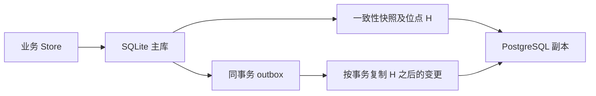

# SQLite 在线迁移到 PostgreSQL 实现方案

[English](../sqlite-postgres-online-migration.md)

状态：实现与本地验收已交付，生产演练待完成。分支：`feat/sqlite-postgres-online-migration`。
跟踪任务：[qbox/sandbox#535](https://github.com/qbox/sandbox/issues/535)。本分支提供显式启用的迁移入口；默认关闭。
本地验证与生产无感验收分别记录，操作步骤见第 11 节。

## 1. 目标与边界

在 SQLite 持续接收线上读写时，将 runnerd 的现用业务数据迁移至 PostgreSQL。
不要求正在执行的 Runner / Deployment 结束，不重新创建 Sandbox，不要求用户重新登录。
最终切库保留同一个 runnerd 进程及其调度、回调、SSE 和 PTY 会话；只允许有预算的数据库操作排队。
排队延迟必须经演练符合入口、客户端及业务超时，不能预先承诺零延迟。

- 已提交业务数据与迁移日志同事务持久化；复制中断、重复投递和进程退出不得形成复制缺口。
- 任意时刻只有一个业务主写库；不引入多实例运行、自动故障切换或跨库分布式事务。
- 观察期保留反向复制；回退前必须追平，不将过期 SQLite 当作可无损立即切回的副本。
- 不清理历史 payload、旧表、日志，不调整现有生命周期、授权、容量和审计语义。
- 开发默认禁用迁移；提交、推送、生产部署及数据操作不由此方案自动授权。

首次安装准备版本仍需要现有进程升级。当前启动恢复会对多数路由返回 503，且 PTY 状态在内存中，
所以不能承诺该次升级完全无感。首次升级的连接排空、入口保护和任务恢复须单独演练；
数据库迁移成功不等于无损进程升级或多实例支持。

## 2. 迁移前基线与实现依据

- `internal/state/db.go`：已有三个数据库驱动；SQLite 使用 WAL 和单连接业务池；
  `DBStore` 固定持有数据库句柄，没有复制、热切换和迁移控制协议。
- `internal/state/store.go`：HTTP、Runner 回调和 Deploy worker 通过组合的 `Store` 接口访问状态。
- `internal/state/identity_audit.go`：业务变更和审计共享事务，失败必须一起回滚。
- `internal/state/deployments.go`：事件删除、追加、预算更新共享事务；版本和执行尝试必须保留。
- `internal/state/runner_requests.go`：状态使用版本条件更新；日志直接写入事件表，写失败当前只记录告警。
  迁移不能把日志写失败伪装成复制成功，必须单独暴露源写失败与复制失败。
- `cmd/runnerd/main.go`、`internal/server/server_terminal.go`：启动恢复门禁、后台调度和终端会话说明
  不能用两个完整实例分别连接两个库做滚动切流。
- `.github/workflows/check.yaml`：已有真实 PostgreSQL/MySQL 的 schema、审计和 Deployment 测试入口，
  本分支另加入迁移捕获、复制、切换、回退、恢复及服务连续性的真实 PostgreSQL 门禁。

## 3. 数据范围与迁移协议

维护显式、版本化的迁移清单，从现用 GORM 模型推导列、主键和类型，不从数据库中自动发现并迁移任意表。
当前范围为 18 张业务表：

| 领域 | 表 |
| --- | --- |
| Runner | `runner_requests`、`runner_events`、`runner_profiles`、`scoped_runner_profiles` |
| Deploy | `deployments`、`deployment_revisions`、`deployment_events` |
| 身份与授权 | `accounts`、`oauth_identities`、`github_installations`、`github_installation_owners` |
| 配置 | `account_preferences`、`account_secrets`、`sandbox_service_defaults`、`sandbox_service_default_audiences` |
| 赞助与审计 | `fork_sponsorship_policies`、`fork_sponsorship_approvals`、`audit_events` |

预检比较实时 schema 与清单，拒绝缺列、无法表示的数据、主键冲突和未知的活动写入路径。
历史额外列和退役表以数量报告，保留源数据库与备份；源自定义索引保留在源文件，由运维清点并复核目标查询计划，
不自动跨方言复制。不恢复已退役功能，不静默丢弃现用字段。
`runner_profiles.default_available` 等惰性兼容列不参与业务匹配，也不借迁移激活。

迁移日志和控制表独立命名，不加入业务目录。每次迁移拥有唯一 ID、协议版本、schema 指纹、
源/目标实例标识、方向、epoch、阶段、复制位点及基线进度。实例标识不使用明文 DSN。
同一迁移不可更换目标库或跨版本接续；未知阶段和不兼容协议拒绝执行。

## 4. 事务变更捕获

采用源库事务内 outbox，复制最终行数据及删除主键，不重放业务方法或外部操作。
单纯顺序调用两个 `Store` 或仅依赖 GORM 保存回调不满足要求。

1. 清点全部写方法、直接 SQL、`UpdateColumns`、批量删除、后台写入和启动数据回填。
2. 在 state 层建立统一写事务入口；事务内嵌套的 Store 必须绑定该事务和同一迁移 epoch。
3. 记录事务组和有序行变更，保留源主键、NULL、布尔值、UTC 时间、版本及密文。
4. 业务与 outbox 任一写入失败则整组回滚；不能先提交业务再在内存排队。
5. SQLite trigger 可用于补齐行捕获，但必须与统一事务入口结合，证明事务分组、原始 SQL、
   删除以及批处理均被覆盖；不能只安装若干 trigger 就宣称无遗漏。
6. PostgreSQL 反向捕获必须按已提交事务排序。普通自增 outbox ID 不等于提交顺序；
   观察期可将业务写事务串行化，以明确的事务锁维护顺序，或实现等价的已提交事务协议。

复制器只向明确标识为副本的数据库写入。应用一组源事务和更新目标复制位点同事务提交；
崩溃重放必须幂等。副本写入不再次产生反向 outbox，防止循环。
源事务回滚不产生可见变更。复制器不解密凭据、不输出行内容、SQL 参数或 provider 细节。

迁移期间禁止绕过协议的旧版本或手工业务写入；schema 升级与复制协议变更必须显式协调。
复制日志仅在基线、正向/反向消费者和恢复检查均不再依赖后回收；保留大小、积压、磁盘余量须有界。
目标故障可暂停复制并阻止切库；源磁盘持续耗尽时不能无限承诺可用性，须提前告警并执行预定处置。

准备版本的具体存储协议如下，控制表只在显式启用迁移时创建：

- `runnerd_migration_control` 保存迁移 ID、协议/schema 指纹、数据库角色、epoch 和当前写事务组。
- `runnerd_migration_transactions` 为每个源写事务分配有序位点；
  `runnerd_migration_changes` 保存该组的表名、主键、操作和最终行数据。
- 每组保存已提交前驱位点，`runnerd_migration_frontiers` 与业务/outbox 同事务保存各 epoch 的提交尾位点；
  复制校验前驱链和尾位点，区分正常回滚跳号与中间/尾部整组日志缺失，不把下一组当作连续数据。
- `runnerd_migration_checkpoints` 保存副本已应用位点；业务表及事务位点同事务提交。
- 在 GORM `ConnPool.BeginTx` 边界为显式事务与 GORM 自动写事务建立事务组，
  保留现有业务原子性，SQLite 行 trigger 捕获实际变更。
  GORM 默认写事务须保持启用；直接原始 SQL 必须置于受管事务内，绕过者拒绝执行。
  内层审计事务和保存点复用同一组，回滚到保存点也移除相应捕获行。
- PostgreSQL 观察期在任何业务 SQL 前锁定 control 行，之后分配组位点；
  这在观察期显式串行化写事务，保证已提交组不存在较小位点稍后提交而被跳过的情况。
- 副本应用在同一目标事务内设置受限的复制上下文；trigger 不回捕，但仍禁止普通业务写入副本。
  启动回填也是受管写入；迁移活动期间 schema 指纹变化拒绝启动，不能静默执行不兼容 DDL。

## 5. 在线基线与增量复制



先启用捕获，再通过 SQLite 支持的一致性快照取得数据及同快照内的位点 H。
迁移读取使用独立连接，避免占用当前单连接业务池；优先短批次、可续传的基线导入，
限制带宽、批次、锁等待、快照时长和 WAL 增长。不得将各批次独立读视图冒充同一快照。
若使用在线备份，必须从备份内读取 H；复制正在使用的 `.db` 文件不构成正确的 WAL 快照。

当前选用 SQLite `VACUUM INTO` 生成独立、可续传的只读基线文件；这不是对源库执行原地 `VACUUM`。
通过独立连接在 WAL 模式读取一致性视图，输出文件及其父目录 fsync 后，
检查文件权限、实例/epoch、完整性及文件内位点。后续导入只读取 immutable/只读快照，
不长期占用线上读事务。快照创建有调用方 deadline；取消时只清理由本次调用新建的文件。

快照以 SHA-256 摘要绑定恢复进度；目标 `runnerd_migration_baseline` 同时记录源实例、epoch、
schema 指纹、位点 H、当前表、最后复合主键和累计行数。每批最多 1,000 行，数据及进度同事务提交。
不同快照、非空目标、缺少完成基线的回放、来源身份变化及位点倒退均被拒绝。
增量读取使用独立连接及有 deadline 的只读事务，按完整事务组回放，
每次流式读取至多 256 条变更；单组目标数据及位点只提交一次，不按读取页拆开源事务。

跨方言时间统一为 UTC、截断到 PostgreSQL 的微秒精度；源 SQLite 原值不批量改写。
校验在两侧应用相同规范化，明确不承诺保留纳秒尾数。
PG 读取的微秒时间在回退后仍可识别 SQLite 未变化行的原纳秒值，并继续使用原值执行精确 SQL 条件更新；较新版本仍拒绝。
SQLite 收尾后的兼容标记继续保留这一规则，普通未迁移数据库的条件更新行为不变。
数值使用整数解析，保留大于 2^53 的 ID；NULL、false、零值和密文按原列值导入。
不支持的数值、非法 UTF-8 或 PostgreSQL 文本无法表示的 NUL 拒绝导入，不静默替换。
目标驱动错误可能包含整行数据，因此复制错误只输出服务端错误类别，不输出底层错误正文。

目标先按显式 schema 建表，再导入基线，最后重放 H 之后的变更，避免旧基线覆盖新行。
迁移导入不运行生命周期逻辑、策略回填、GORM 自动更新时间或审计业务入口。
基线、复制和校验均需持久化进度、取消及恢复语义；失败不改变主库身份。
非空目标库默认拒绝，恢复必须匹配同一迁移标识及进度。

## 6. 一致性校验与切换门禁

按清单顺序和主键顺序校验。规范化编码包含列类型、NULL 与值，避免时间精度、布尔表示、
NULL/空字符串或密文的跨方言差异造成漏报。导出及摘要工具不得记录明文凭据或密文原文。

- 基线阶段完成全表分块行数和摘要校验；两侧必须对齐同一复制位点。
- 在线刷新全量校验锚点 V：SQLite 生成独立快照，PostgreSQL 使用独立 repeatable-read 视图；副本精确追到该视图位点后校验，源库继续写入。
- 切换屏障只枚举 `(V,F]` 中变更过的主键（含删除与改主键），复核源/目标当前行；最多 10,000 条变更，超出则取消本次切换，不在排队窗口执行全库扫描。
- 检查版本、Sandbox/PID、attempt、revision、lease、事件预算、授权关联及审计完整性。
- 保留所有业务/事件 ID，保留游标顺序；序列校准取现存 ID 与源历史分配高水位的安全上界。
- 保持 `auth.session_secret`、`auth.encryption_key` 和原有密文，验证已有 Cookie 和凭据可用。
- 要求捕获无缺口、复制无错误、目标健康、校验通过、反向捕获已就绪、容量充足。

## 7. 进程内切库

通过一个稳定的 Store 门面切换底层数据库，不替换 Server、worker、Terminal Hub 或 Sandbox。
读写操作与整个事务固定在同一底层 Store；取得裸 GORM 句柄后不能越过操作边界继续使用。

1. 设置有超时和容量限制的操作屏障，让新数据库操作排队，等待旧操作结束。
2. 屏障覆盖 API、调度器、清理器、日志、退出回调和 Deploy；不持锁等待 GitHub/Sandbox 网络调用。
3. 冻结源提交位点 F，完成最后复制、增量校验及目标序列校准。
4. 通过持久化控制协议提交主库身份、递增 epoch，并切换门面。
5. 释放排队操作，继续原进程中的任务、SSE 和 PTY；开始 PostgreSQL 到 SQLite 的复制。

排队预算或校验失败时，主库仍为 SQLite，释放队列并取消该次切换。
Store 门面通过生成的完整接口转发固定整个方法及审计事务；`go generate ./internal/state`
更新转发代码，新增接口但未生成时编译失败。日志等无返回值方法也排队，不因屏障静默丢弃。
排队数量越过预算会取消准备，所有调用等待控制器恢复安全角色后继续；这是切换取消阈值，
不是通过拒绝溢出调用实现的硬队列上限。提交 authority 后出现故障只能恢复新主库，不能取消回旧库。
屏障不等于停止 HTTP 服务，不拒绝正常请求以宣称迁移成功；必须证明排队没有超出请求和 lease 预算。
具体延迟阈值由生产入口与演练确定，不预设未经验证的毫秒承诺。

切换控制协议必须明确持久化提交点。源库、目标库和本地 manifest 不存在天然原子提交，
因此要为每个 prepare/commit 步骤定义崩溃恢复判定；以已确认的 durable authority 决定主库，
状态无法判定时拒绝启动业务写入。切换提交后禁止因旧 DSN 配置或目标暂时不可用而自动回 SQLite。

本次采用本机持久化 authority manifest 作为唯一切换提交点，符合当前单进程部署边界。
manifest 位于受限权限的迁移状态目录，只记录实例标识、epoch、位点和阶段，不保存 DSN 或密钥；
通过临时文件写入、文件 fsync、原子 rename 和目录 fsync 提交。
正常运行持有独占进程锁。manifest 必须纳入恢复备份，不能只备份数据库。

manifest 带规范化编码校验和、单调 revision 和源/目标身份校验，拒绝损坏、重复字段及过期更新。
状态目录、文件和锁只允许私有权限，拒绝符号链接，并持有 OS 独占锁。
rename 之后即报告已发布，即使目录 fsync 失败也不能将该错误当作未提交而恢复旧主库；
此时当前 authority 句柄拒绝继续使用，恢复必须重新确认文件与目录持久性。

| 崩溃位置 | 恢复判定 |
| --- | --- |
| 尚未准备 | 继续 manifest 指定的原主库 |
| 已写 prepared，原主库已禁止业务写入，尚未提交 authority | 目标保持禁止业务写入；验证 manifest 后恢复原主库角色，取消本次切换 |
| 新 authority 已持久提交，尚未切换内存门面/开放目标 | 只允许连接并开放新主库，幂等完成角色设置及门面恢复 |
| 已开放新主库 | 沿用新 epoch 和反向复制；不能把超时当作未提交而回旧主库 |
| 数据库显示活动迁移但 manifest 缺失、损坏或身份不符 | 拒绝业务启动，进入显式恢复流程，不根据 DSN 猜测 |

authority 提交前允许取消；提交后只能完成恢复或发起一次新的受控回退。
配置须同时保留两端连接信息，重启先解析 manifest 再初始化业务 Store，不能先对旧 DSN 执行启动回填。
这不是跨主机选主协议；迁移期换机、状态目录丢失和多进程接管均需单独恢复验收。

## 8. 观察、回退与收尾

观察期 PostgreSQL 为唯一主库，SQLite 为只接收复制的副本。反向捕获必须在开放 PostgreSQL 业务写入前启用。
回退使用相同屏障、最后位点、序列校准、authority/epoch 提交和恢复协议。
反向积压未追平时拒绝无损回退；PostgreSQL 整体不可访问且存在未复制提交时，不能承诺立即零损失恢复。
不引入未经验证的自动故障切换，不在两个库同时运行调度器。

观察期通过后，显式结束迁移、保留只读备份及证据，再在后续版本中删除迁移入口和临时兼容代码。
观察期长度、备份保留、outbox 上限及告警阈值由上线清单确定；本方案不自动删除历史数据库。

## 9. 实施阶段与验收

| 阶段 | 交付物 | 验收 |
| --- | --- | --- |
| P0 | 中英文方案、跟踪 Issue、分支和目标；表清单、协议状态及门禁基础 | 清单覆盖现用模型，阶段转换 fail closed，默认运行无变化 |
| P1 | 统一写事务、事务 outbox、捕获覆盖测试 | 审计/业务/outbox 原子性，原始 SQL、批量写及删除无缺口 |
| P2 | 独立连接快照、基线导入、幂等复制及同位点校验 | 写入同时导入，重复投递、断连、退出和续传，无 ID/字段损失 |
| P3 | 稳定 Store 门面、屏障、authority/epoch 与命令入口 | 并发读写、在途事务、超时取消、每个提交点退出恢复；无旧库迟到写入 |
| P4 | 反向复制、受控回退、容量与状态观测 | 新增 PG 数据回退保留，循环抑制，提交乱序不漏数据，失败拒绝切换 |
| P5 | 运维手册、故障演练、真实数据库与业务验收 | SQLite/PostgreSQL 本地真实方言通过；生产副本及线上验收单独记录 |

每阶段同步本文状态与公开文档，不自动提交、推送或部署。P0/P1 完成不代表可迁移生产。

测试从 `go test ./internal/state -count=1` 开始，保留 SQLite 老 schema 测试；跨方言修改执行
项目现有 PostgreSQL/MySQL `*_test` 数据库门禁，并增加 SQLite → PostgreSQL → SQLite 的迁移集成测试。
调用方变化执行相关 server/worker 测试及 `go test ./...`；合入前执行项目要求的完整检查。

故障矩阵覆盖源事务回滚、outbox 失败、目标超时且提交结果未知、重复应用、删除重建、
空表、复合主键、历史序列高水位、并发配置修改、审计失败、日志持续写入、基线中断、
源/目标/复制器重启、各切换提交点崩溃、反向积压和错误的迁移配置。

生产验收必须同时保留真实 Runner Job、Deployment 和同一个已打开 Web Terminal，
记录请求错误率/延迟、事件连续性、登录态、Sandbox/PID、创建及清理次数。
不能用重开终端、重新创建 Sandbox 或仅通过 `/healthz` 证明无感迁移。

## 10. 当前执行记录

- P0：已完成。方案、跟踪 Issue、分支和目标已建立；新增表/列/复合主键清单、
  schema 指纹、协议阶段边界和切换证据校验基础；迁移默认关闭。
- 验证：`go test ./internal/state -count=1`、`task lint`、文档链接及代码格式检查通过。
  测试核对真实新建 SQLite schema，不代表已经验证复制、实际切库或 PostgreSQL 迁移。
- P1：已完成 SQL 事务边界捕获与 18 张业务表 trigger，通过显式迁移配置启用。
  SQLite 及 PostgreSQL 17 的嵌套审计事务、批量原始 SQL、主键变更、保存点回滚、
  日志写入和旧句柄拒绝测试通过；SQLite 另覆盖 outbox/提交/审计失败回滚与并发写入。
  PostgreSQL 测试证明取消等待的写事务不会越过提交顺序锁，也不会阻塞后续正常写入。
- P2：核心实现及本地方言验证完成。独立一致性快照、SHA-256 绑定恢复、逐表主键分页导入、
  按事务幂等回放和同位点全表分块校验已实现，通过本机命令与后台任务推进。
  SQLite/PostgreSQL 17 验证覆盖 18 张表、NULL/false/零值、复合主键、Unicode、2^53 以上 ID、
  微秒时间及条件更新、基线中断续传、并发消费者和副本循环抑制。
  测试证明保持源流式读取事务时业务写入仍可提交；目标行/位点失败、PG 连接终止、
  outbox 缺失或损坏均不会留下部分事务；重试可追平。身份/epoch 漂移、源回退、
  不同位点及目标数据损坏被拒绝；失败复核清除旧成功标记。
- 本轮真实方言门禁：PostgreSQL 17/MySQL 8.4 的现有 schema、审计、Runner Spec、Deployment 测试通过。
  捕获仅支持 SQLite/PostgreSQL，未扩展为 MySQL 在线迁移。
- P3：已实现运行入口。稳定 Store 门面、有限屏障、真实 trigger 验证、主库冻结、最终增量复核、
  历史分配序列高水位、authority/epoch 提交与启动恢复已接入；提交后的取消只完成新主库，禁止自动回旧库。
  默认启动遇到活动迁移库会拒绝，防止遗漏配置时先向副本运行 backfill。
- P4：已实现正向/反向后台复制、在线校验锚点刷新、受控回退、状态/积压/容量提示、分批日志回收、
  收尾与取消；收尾后当前主库才获得 standalone 标记，旧副本继续禁止业务写入。
- P5：本地真实 PostgreSQL 17/MySQL 8.4 兼容门禁与服务夹具验证已完成；生产副本、真实流量及 provider 验收待执行。
  正向切换覆盖错误返回、实际子进程退出、prepared/committed 文件目录 fsync 不确定及提交后取消；
  回退覆盖 prepared、authority 已提交、新主库已开放三个边界的子进程退出。
  额外验证正反向整组日志被移除时拒绝推进，PG 事务回滚留下的序号空隙仍可正常复制。
  服务测试保持同一 Server、worker、Terminal Hub、SSE 连接与假的 PTY，日志持续写入不丢失、不重复；
  Runner Sandbox/PID 与 Deployment attempt/version 保持。这不等于真实 Sandbox/代理/PTY 已验收。
- 验证入口：`task lint`、`task test`、`task state-online-migration-test` 与真实数据库 CI 门禁。
  本地 `go test ./...` 会扫描忽略的 `var/pr133-readiness-*_test.go` 并因混合包失败；
  项目入口使用 `./cmd/... ./internal/...`，没有删除或改写这些旧临时文件。
- 本分支尚未提交或推送，未读取生产数据库、修改生产配置或操作线上资源。
- 上线前待采集：数据库及 WAL 大小、事件写入速率、磁盘余量、流量/超时预算、
  部署及反向代理方式、现有长连接、PostgreSQL 版本/网络/备份恢复条件。

## 11. 操作手册与发布门槛

以下命令仅针对已演练、显式授权的服务。当前工作不执行生产迁移。
先安装本分支准备版本；这一升级仍会替换旧进程，须单独安排长连接排空与任务恢复。
若旧库没有 preference/secret scope 列，沿用现有升级规则会重置这些旧配置表；
必须准备重新配置 Sandbox、GitHub 重新认证，并在认证后同步 Installation。

### 11.1 准备配置和备份

保存源库的一致性备份、受保护配置及迁移 authority 目录，并演练恢复。不要直接复制正在使用的 `.db` 文件。
目标使用专用空 PostgreSQL database/schema；首次初始化拒绝未知表、已有业务行或其他迁移身份。
源端历史额外表/列只保留在源文件和备份，状态返回其数量，目标只迁移第 3 节的模型清单。
迁移期间不得运行不兼容旧二进制、第二个 runnerd 或手工业务 SQL；不得修改 schema、连接目标或清理迁移元数据。

```yaml
database:
  backend: sqlite
  dsn: ./var/runnerd.db
  online_migration:
    directory: ./var/migration
    postgres_dsn: 'host=pg.example.internal user=runnerd password=REPLACE dbname=runnerd sslmode=verify-full'
    initialize: true
    pause_budget_milliseconds: 500
```

路径相对配置文件解析。目录的父目录须存在，迁移目录权限为 `0700`，文件和控制 socket 为 `0600`；
目录、manifest 和锁不接受符号链接。PG DSN 支持 `RUNNERD_ENC(v1:...)`，仍须保护配置文件。
第一次初始化成功后移除 `initialize`；恢复只允许原有 authority，缺失/损坏时拒绝启动，不新建来猜测主库。
即使 PG 已成为主库，也保留 `backend: sqlite`、原 SQLite 路径及两端连接配置，直到显式收尾。

### 11.2 基线、追平与切换

所有命令都通过私有本机 Unix Socket 送到正在运行的同一个服务进程。CLI 不打开数据库，不替换 Server。
命令仅接受固定操作名；同时只执行一个运维命令。运行用户须能访问迁移目录和 socket。

```bash
runnerd --config /path/to/runnerd.yaml --migration-command status
runnerd --config /path/to/runnerd.yaml --migration-command prepare
# 后台每 250 ms 导入一批（256 行）；基线完成后每轮回放最多 128 组。
runnerd --config /path/to/runnerd.yaml --migration-command status
runnerd --config /path/to/runnerd.yaml --migration-command verify
runnerd --config /path/to/runnerd.yaml --migration-command cutover
```

`prepare` 绑定一致性快照及摘要。`baseline`、`replay` 可手动推进有界批次；完成后不要重发 `baseline`。
快照/命令最长 120 秒；后台操作每轮 5 秒、每分钟全量复核最多 30 秒。
大库可显式执行 `verify` 获取较长的校验预算；复核失败不改变主库。
`cutover` 只接受 `ready` 的 SQLite 主库，重发不会触发回退；后台永不自动切库。
默认排队准备预算 500 ms，可配置 50–5,000 ms；100 个等待调用会触发取消准备。
该阈值不是硬队列上限；角色恢复另有 5 秒预算，因此故障下不能承诺等待只持续 500 ms。

`status` 提供阶段、唯一主库、epoch、源/应用/校验位点、待复制事务组、后台错误类别、
逻辑 outbox 字节数、保留水位、源额外表/列数量和本机可用空间，不提供行、密钥、DSN 或文件路径。
逻辑 outbox 超过 1 GiB 或本机快照/SQLite 磁盘可用空间低于 256 MiB 会提示容量风险并拒绝切换。
创建快照前另要求至少主库文件 + WAL 大小 + 256 MiB 的可用空间。
这些不是磁盘硬配额；须独立监控 PostgreSQL 服务端磁盘、索引、WAL、复制网络和 SQLite WAL 增长。

### 11.3 观察、回退和日志保留

观察期保持后台 PG → SQLite 复制，每分钟刷新校验锚点。检查 API 延迟/错误率、复制积压、
Runner/Deployment/Sandbox/PID、日志连续性、原终端与 Cookie，不能只看 `pending_groups=0`。

```bash
runnerd --config /path/to/runnerd.yaml --migration-command verify
runnerd --config /path/to/runnerd.yaml --migration-command rollback
```

回退补齐最后已提交变更并递增 epoch。若最终窗口超出预算，原主库继续服务；先在线 `verify` 刷新锚点再重试。
原请求连接中断、超时或返回错误后，必须先看 `status`；authority 可能已经提交，不能按旧 DSN 猜测结果。
`recovery_required` 或不可读取 authority 时保留两端数据库、目录和配置，恢复同一目录后重启本版本；
不能删除 manifest、手改角色、重建空目标或启动旧版本。PG 不可访问时不会自动回 SQLite。

`prune` 每次最多回收 256 条、128 个已验证事务范围内的迁移变更 payload，受排队预算同样约束；
事务头保留，完整事务回收水位与删除一起提交。超大事务可分多次执行；落后于保留水位或缺少完整组的副本拒绝回放。
仅在基线已完成、已验证且恢复备份齐备时由运维显式调用，不自动清理；压缩物理空间需要另行维护计划。
该操作不删除业务事件、历史 webhook payload、旧表、数据库、快照或备份。

### 11.4 收尾或取消

```bash
# PG 观察通过，或回退到 SQLite 后决定结束迁移：
runnerd --config /path/to/runnerd.yaml --migration-command finish
# 尚未切到 PG，放弃本次迁移：
runnerd --config /path/to/runnerd.yaml --migration-command abort
```

`finish` 只接受 PG 主写或已完成回退的 SQLite；`abort` 只接受切换前 SQLite 主写阶段。
它们先提交终态 authority，再在同一主库事务中撤掉捕获 trigger 并写 standalone 标记。
收尾崩溃由终态 manifest 恢复；旧副本始终禁止业务写入。收尾不支持再迁移或回退，需要新的明确维护方案。
成功后保持当前进程服务，后续正常升级可将 `database.backend/dsn` 指向最终主库并移除 `online_migration`。
旧数据库、快照、迁移日志与目录按备份策略保留，不自动删除。

生产发布门槛：生产副本全量演练与恢复、入口/客户端/lease 超时预算、真实 Runner Job、Deployment 和同一个
已打开 Web Terminal 连续性验收、请求错误率及 P95/P99 延迟、磁盘与速率容量测量，全部须有独立记录。
